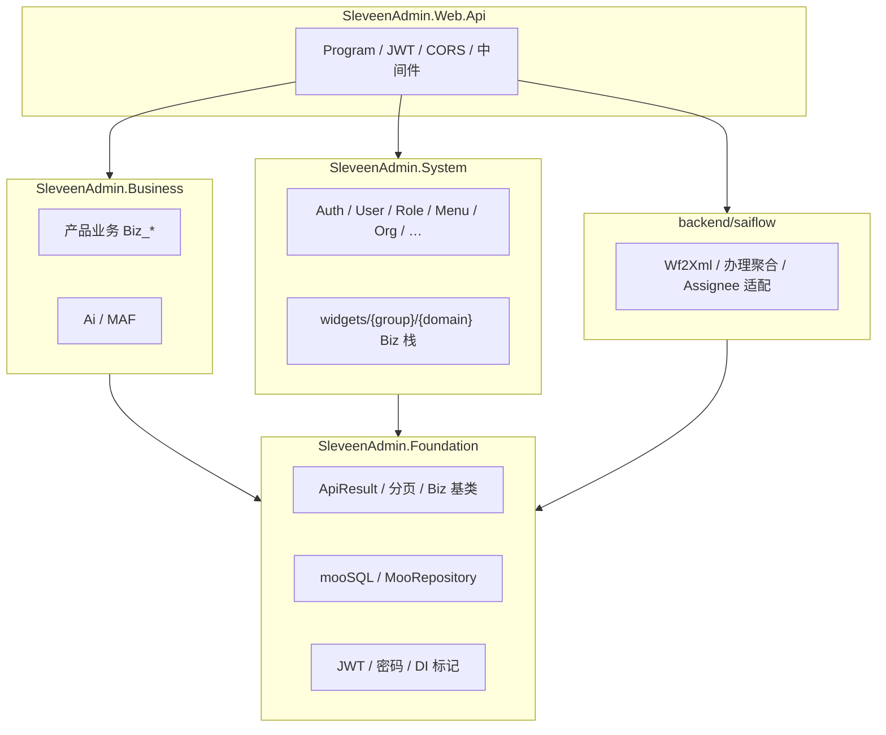

# sleveen-admin 建设方案与架构约束

> 更新：2026-11-08  
> 仓库：**sleveen-admin**  
> 历史实施归档：[doc/archive/IMPLEMENTATION-R1-R11.md](./doc/archive/IMPLEMENTATION-R1-R11.md)  
> 功能蓝本曾参考 Admin.NET；ORM：`mooSQL.Ext`；流程引擎：独立仓 **sailflow**（本仓 `backend/saiflow` Host）  
> 壳层专题：[doc/无界模式/无界模式.md](./doc/无界模式/无界模式.md)

---

## 1. 目标

把 sleveen-admin 建成 **可长期堆叠业务、且适合 AI 辅助开发** 的后台底座：

| 目标 | 含义 |
|------|------|
| **业务分层清晰** | 宿主 / 系统域 / 产品业务 / 流程 Host 边界钉死；新需求知道落哪一层、哪一类文件 |
| **业务堆叠不崩** | 按模块纵向加功能，禁止横向「大泥球」；配置、菜单、权限、数据访问有固定落点 |
| **AI 可写可改** | 范式文档齐全、命名与目录可推断；Agent 按范式生成 Biz/Page/VC，而不是猜框架内部魔法 |
| **产品能力演进** | AI 助手深化、审批工作流持续打磨、平台权限与稳定性继续补强 |

R1–R11 平台底座（RBAC、基础设施、YARP、AuthBag、MAF AI 骨架等）**已完成并归档**；本文描述**现行约束**与**下一阶段路线**，不再复述旧轮次清单。

---

## 2. 硬约束（摘要）

| 维度    | 决策                                                              |
| ----- | --------------------------------------------------------------- |
| 运行时   | **.NET 10**（`net10.0`）                                          |
| ORM   | **mooSQL.Ext**（源码 ProjectReference）；                            |
| 主键    | **Guid v7**；列名表前缀（如 `Su_Account`）                               |
| 数据库   | 开发默认 **SQLite**；可切 SQL Server 等                                 |
| 业务 DI | **禁止** Java 式 `IXxxService` + `XxxServiceImpl`；业务用具体 `*Service` |
| 前端壳   | Soybean Admin **深度改造副本**（见 §4）；不以上游 Naive 模板为运行时依赖              |
| 流程    | 引擎在 **sailflow**；本仓只做 Host + `widgets/sailflow` 产品面             |

---

## 3. 后端框架：分层与配置

### 3.1 分层策略



| 项目 | 职责 | 禁止 |
|------|------|------|
| **Foundation** | ApiResult、mooSQL 封装、安全、DI 标记、Biz 基类 | 具体业务表 CRUD、产品 Controller |
| **System** | 平台域（用户/角色/菜单/租户/文件/日志…）及 `widgets/` 下系统 Biz 栈 | 产品行业逻辑、引擎实现 |
| **Business** | 产品业务域 Biz 栈、AI 等扩展 | 改 JWT/中间件、塞流程引擎内核 |
| **saiflow** | Sail 引擎 HTTP 适配、Workbench、宿主身份/角色展开 | 替换引擎、把业务表 CRUD 写进引擎 |
| **Web.Api** | 宿主：`Program`、管道、权限 Handler、配置扫描入口 | 写 Entity / 业务 Service |

**依赖硬约定：**

```text
System     → Foundation
Business   → Foundation
saiflow    → Foundation（+ 外部 sailflow 引擎引用）
Web.Api    → System + Business + Foundation + saiflow
```

同层模块之间避免循环引用；跨域协作走 API 或明确的应用服务，不互相掏 `DBLayer`。

### 3.2 域内纵向切片

每个业务域固定：

```text
DBLayer/     → 实体 / 表映射
Service/     → Biz_*Row + Biz_*Service（查询与领域逻辑）
Controller/  → Biz_*Controller（页面 API：init + CRUD）
Dtos/        → 必要时的入参出参（非 Biz 页面也可）
```

细则与前端对应关系见 [doc/biz-module-paradigm.md](./doc/biz-module-paradigm.md)；mooSQL 用法见 [doc/mooSQL-integration.md](./doc/mooSQL-integration.md)。

### 3.3 依赖注入

- 业务：`UserService` / `Biz_*Service` 等 **具体类** + Scrutor（`*Service` → Scoped，或 `ITransient` / `IScoped` / `ISingleton` 标记）
- 允许基础设施抽象：`IDbInitializer`、`IIdGenerator` 等跨层可替换契约
- **不要**为每个业务 Service 再套一层仅转发的接口

### 3.4 分散配置 JSON

配置按关注点拆文件，避免单文件 `appsettings` 膨胀、也便于 AI/人按文件改项：

| 机制 | 说明 |
|------|------|
| 扫描目录 | `appsettings` 中 `ConfigurationScanDirectories`（如 `Configuration`、内容根） |
| 分片文件 | `Web.Api/Configuration/*.json`（如 `Jwt`、`Redis`、`Ai`、`DBCoonfig`、`Hangfire`、`Frontend`…） |
| 环境覆盖 | 可选 `{Name}.{Environment}.json` |
| 绑定 | 标准 `IConfiguration` → `IOptions<T>`；产品开关可再镜像 `SysConfig` 供管理端 CRUD |

原理与复刻说明：[doc/json-config-shard-replication.md](./doc/json-config-shard-replication.md)。

**约定：** 新基础设施能力优先加独立 JSON 分片 + Options 类，而不是往根 `appsettings.json` 堆大段。

### 3.5 解决方案树（现行）

```text
sleveen-admin/
├── PLAN.md
├── doc/                       → 专题与归档
├── backend/
│   ├── sleveenAdmin.sln
│   ├── core/
│   │   ├── SleveenAdmin.Foundation/
│   │   ├── SleveenAdmin.System/
│   │   ├── SleveenAdmin.Business/
│   │   └── SleveenAdmin.Web.Api/
│   ├── saiflow/
│   └── tests/
└── web/
```

---

## 4. 前端框架：Soybean 深度改造

上游 [Soybean Admin](https://github.com/soybeanjs/soybean-admin) 仅作**脚手架血缘**；本仓 `web/` 是**可独立演进的改造副本**，不是「尽量少改上游」。

### 4.1 相对上游的主要改造

| 维度      | 上游典型           | sleveen-admin                                                      |
| ------- | -------------- | ------------------------------------------------------------------ |
| UI 组件库  | Naive UI       | **Element Plus**（含 `@element-plus/icons-vue`、`vue-element-plus-x`） |
| 主题 / 布局 | Soybean 默认壳    | 保留布局/路由/权限壳思路，样式与组件 API 全面 Element 化                               |
| 业务组织    | 散落 views       | `widgets/` **模块化**：平台页 + 业务 Page/VC + `sailflow` 工作台               |
| 业务范式    | 无强制            | **Biz_ 页面 + VC_ 组件 + PageApi**，与后端 Biz 栈 1:1（见范式文档）                |
| 路由      | elegant-router | 保留；动态菜单对齐 `/api/auth/user-info`、`/api/sysMenu/login-menu-tree`     |
| API     | 模板约定           | 统一平台 `code/msg/data`；Sailflow 走 `ResponseResult` 客户端               |
| AI UI   | —              | `vue-element-plus-x` 流式助手                                          |

### 4.2 目录与职责（概念）

```text
web/src/
├── layouts / router / store / service   # 壳：布局、动态路由、鉴权、HTTP
├── views/                               # 壳级页面（home、manage、infra、ai…）
└── widgets/                             # 可堆叠业务包
    ├── …                                # 系统/业务 Biz 模块（Page + VC + api）
    └── sailflow/                        # 流程工作台（设计器、办理、列表…）
```

- **壳**负责登录、菜单、权限指令、多页签；**不**承载行业表单细节。  
- **新业务**优先落 `widgets/`，按范式加 Page/VC/api，再挂菜单；避免在壳目录无限长出无边界页面。  
- **流程**统一进 `widgets/sailflow`，不与平台管理页混目录。

### 4.3 与 AI 开发的关系

前端改造的目的之一是让 Agent **有稳定模板可抄**：

1. 先读 [doc/biz-module-paradigm.md](./doc/biz-module-paradigm.md)
2. 按 Biz_/VC_ 命名与目录生成
3. 列表/表单交互走 Element Plus 既有模式，不引入第二套 UI 库

禁止为单页再引入 Naive / 其它全量 UI 栈，避免双框架拖垮可维护性。

---

## 5. 技术栈对照（现行）

| 能力 | 方案 |
|------|------|
| 宿主 | 标准 `WebApplication` + 分散 JSON 配置 |
| DI | Scrutor + 生命周期标记 + `*Service` 约定 |
| ORM | mooSQL `DBInsCash` / `MooRepository<T>` |
| 缓存 | StackExchange.Redis |
| 定时任务 | Hangfire.MooSql（复用主库 + `hf_` 前缀；默认开） |
| 反向代理 | YARP 内嵌 Web.Api |
| 统一响应 | 平台 `ApiResult`；Sail Host `ResponseResult` |
| AI | Microsoft.Agents.AI (MAF) + 前端流式组件 |
| 流程 | sailflow 引擎 + `backend/saiflow` + `widgets/sailflow` |

---

## 6. 已落地能力（不展开轮次）

- 认证授权、RBAC、组织、字典、配置、AuthBag  
- 文件、日志、监控、Redis 键值、多租户、公告、在线用户、Hangfire  
- YARP 开发代理 / 生产 SPA / Docker 单端口  
- AI 助手流式对话（骨架）  
- Sailflow 流程工作台挂载（设计、表单、待办办理、分类/模板/报表等，详见 `doc/sailflow-*.md`）

---

## 7. 未来路线图

总原则：**在 AI 开发场景下，业务分层清晰、堆叠不崩**——文档、目录、配置、范式先于「再堆功能」；壳层继续向「无界一体」演进。

入口摘要与勾选状态亦见 [README.md](./README.md)「路线图」。

### 7.0 已落地（底座与壳，摘要）

- [x] R1–R11 平台底座 — [归档](./doc/archive/IMPLEMENTATION-R1-R11.md)  
- [x] Sailflow 流程工作台挂载（见 `doc/sailflow-*.md`）  
- [x] 左栏无界默认布局（`vertical-card`）+ App 根布局 class  
- [x] 无界 Vue（`menuType=4`）：悬浮侧栏、压缩顶栏/页签、mainpan 穿透  
- [x] 首页门户：`homePage` 氛围底 + `BorderlessDiv` + `paotal` 穿透  
- [x] 专题：[doc/无界模式/无界模式.md](./doc/无界模式/无界模式.md)

### 7.1 无界与门户

- [ ] 业务子门户 `Biz_*Portal` 按 [实施计划](./doc/pc/design/业务子门户工作台实施计划.md) 落地  
- [ ] 更多工作台菜单切 `menuType=4`，外壳统一「外层氛围 + BorderlessDiv + 穿透 paotal」  
- [ ] 门户切换本地缓存与多方案切换打通  
- [ ] 氛围一体感与卡片玻璃继续打磨（勿再叠 mainpan 实色壳）

### 7.2 AI 能力

- [ ] 会话持久化与历史检索  
- [ ] 知识库与业务/流程活动联动（不仅聊天窗）  
- [ ] Agent 工具调用边界（只碰 Biz/API，不直接改宿主管道）  
- [ ] 管理端可配置模型/指令（与 `Configuration/Ai.json`、SysConfig 双轨对齐）

### 7.3 审批工作流优化

- [ ] 办理闭环 UAT 与体验打磨（选人、下一跳、按钮设置、详情布局）  
- [ ] 待办人策略与宿主主数据持续对齐（Account / 角色展开）  
- [ ] 转办/委派等产品语义（有引擎能力再封装，不强行伪造）  
- [ ] 设计器与表单侧栏缺口按专题文档收口  

权威说明：[doc/sailflow-features.md](./doc/sailflow-features.md) 及同目录其它 `sailflow-*.md`。

### 7.4 AI 开发文档齐备

目标：新人 / Agent 只靠仓库文档就能「加一个业务模块」而不拆架构。

- [ ] 保持 [biz-module-paradigm.md](./doc/biz-module-paradigm.md)、[mooSQL-integration.md](./doc/mooSQL-integration.md)、配置分片文档与代码同步  
- [x] Sailflow Host 能力包写法：[sailflow-host-capability-pack.md](./doc/sailflow-host-capability-pack.md) + 引擎 [最佳实践-宿主能力包UseXxx](../sailflow/doc/sail/最佳实践-宿主能力包UseXxx.md)  
- [x] 无界 / 门户壳层专题：[无界模式.md](./doc/无界模式/无界模式.md)  
- [ ] 补齐「如何新增 widgets 业务包 / 如何挂菜单 / 如何加 Configuration 分片」短操作手册  
- [ ] Cursor / Agent 可用的规则与技能与范式对齐（避免生成反模式：业务接口对、单文件巨类、配置写死在代码）  
- [ ] 流程与平台文档交叉索引清晰，减少口头约定

### 7.5 平台与稳定性（并行）

- [ ] 细粒度数据权限与租户边界补强  
- [ ] Seed / 菜单 / 权限标识一致性  
- [ ] 日志审计与运维体验  

---

## 8. 相关文档索引

| 文档 | 说明 |
|------|------|
| [README.md](./README.md) | 仓库入口与快速开始 |
| [doc/无界模式/无界模式.md](./doc/无界模式/无界模式.md) | 无界理念、左栏无界 / 无界 Vue / 门户、背景穿透 |
| [doc/pc/design/业务子门户工作台实施计划.md](./doc/pc/design/业务子门户工作台实施计划.md) | 子门户外壳标准路径 |
| [doc/archive/IMPLEMENTATION-R1-R11.md](./doc/archive/IMPLEMENTATION-R1-R11.md) | R1–R11 实施归档 |
| [doc/biz-module-paradigm.md](./doc/biz-module-paradigm.md) | 业务 Page / VC / Biz 范式 |
| [doc/mooSQL-integration.md](./doc/mooSQL-integration.md) | mooSQL 集成 |
| [doc/json-config-shard-replication.md](./doc/json-config-shard-replication.md) | JSON 配置分片 |
| [doc/sailflow-features.md](./doc/sailflow-features.md) | 流程现行能力 |
| [doc/sailflow-host-capability-pack.md](./doc/sailflow-host-capability-pack.md) | Host Builder 能力包（UseXxx） |
| [doc/sailflow-menu-mount.md](./doc/sailflow-menu-mount.md) | 流程菜单挂载 |

---

## 9. 验收导向（下阶段）

- 按范式新增一个最小 Biz 模块（前后端）不改动 Foundation / Web.Api 管道  
- 新增配置只增加 `Configuration/*.json` + Options，不污染无关分片  
- 流程关键路径可浏览器走通；AI 相关改动有文档落点  
- Agent 按文档生成的代码可通过 code review 中的「分层 / 命名 / 无第二 UI 栈」检查  
- 新无界/门户页：外层氛围 + BorderlessDiv + paotal 穿透，无多余 mainpan 实色壳
