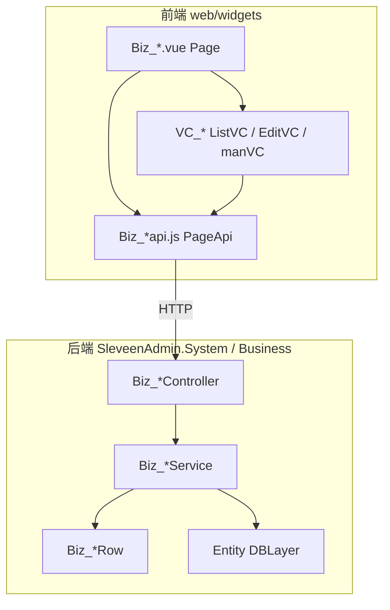

# sleveen-admin 业务模块代码结构范式

本文档为 **sleveen-admin** 业务模块标准规范。业务模块（Page + VC + 后端 Biz 栈）须遵循本范式。

命名约定：页面层与业务服务层统一使用 **`Biz_`** 前缀。

落点：`backend/core/SleveenAdmin.*` + `backend/officeman` 等业务包 + `web/src/widgets`。mooSQL 用法见 [mooSQL-integration.md](../../mooSQL-integration.md)。

---

## 1. 总体分层



| 层 | 职责 | 典型产物 |
|----|------|----------|
| Entity | 物理表映射，`DBTableType.Table` / `[SooTable]` | `{Table}.cs` |
| BizRow | 查询/序列化 DTO，`DBTableType.Select`，Alias=`mtb` | `Biz_{Name}Row.cs` |
| BizService | 分页查询、保存、删除、导出、领域逻辑 | `Biz_{Name}Service.cs` |
| Biz Controller | 页面 API：`init` + CRUD 路由 | `Biz_{Page}Controller.cs` |
| Page | 布局、init、组装 VC、工具栏 / bus | `Biz_{Page}.vue` |
| PageApi | 薄 HTTP 封装，与 Controller 路由 1:1 | `Biz_{Page}api.js` |
| VC | 列表/表单/面板，通过 `props.api` 调接口 | `VC_{Prefix}_{Entity}*.vue` |

运行时 CRUD 以 **BizRow + BizService** 为准；Entity 描述表结构，供编译与建表对齐。

---

## 2. 后端目录树

```
src/
├── SleveenAdmin.Foundation/             # BizServiceBase、BizControllerBase
├── SleveenAdmin.System/src/widgets/     # 系统域模块
│   └── {group}/{domain}/
│       ├── DBLayer/{Table}.cs
│       ├── Service/Biz_*Row.cs, Biz_*Service.cs
│       └── Controller/Biz_*Controller.cs
├── SleveenAdmin.Business/src/           # 业务域模块（同构）
│   └── {domain}/
│       ├── DBLayer/
│       ├── Service/
│       └── Controller/
└── SleveenAdmin.Web.Api/                # 宿主；扫描 Controllers
```

| 项目 | 职责 |
|------|------|
| `SleveenAdmin.Foundation` | 基类、`MooRepository`、ApiResult、鉴权工具 |
| `SleveenAdmin.System` | 系统/平台域 Biz 栈 |
| `SleveenAdmin.Business` | 产品业务域 Biz 栈 |
| `SleveenAdmin.Web.Api` | 宿主；不写业务 Entity / Service |

**依赖硬约定：**

```
SleveenAdmin.System    ──► SleveenAdmin.Foundation
SleveenAdmin.Business  ──► SleveenAdmin.Foundation
SleveenAdmin.Web.Api   ──► System + Business + Foundation
```

禁止 Business ↔ System 互相引用；禁止业务项目直接引用外部 Furion / SqlSugar。

### 2.1 标准 CRUD 模板（以 `Sa_Xxx` 为例）

| 角色 | 约定路径 |
|------|----------|
| Entity | `src/SleveenAdmin.Business/src/{area}/DBLayer/Sa_Xxx.cs` |
| BizRow | `.../Service/Biz_Sa_XxxRow.cs` |
| BizService | `.../Service/Biz_Sa_XxxService.cs` |
| Controller | `.../Controller/Biz_Sa_XxxListController.cs` |

基类：`BizControllerBase` / `BizServiceBase`，置于 Foundation。

### 2.2 各层要点

#### Entity

- `[SooTable(Name="{Table}", Type=DBTableType.Table)]`（或 `[SooTable("…")]` + `[SooColumn]`）
- 主键：`{TableName}OID`（`Guid?` / Guid v7）
- 系统字段：`SYS_Created`、`SYS_LAST_UPD`、`SYS_Deleted`、`SYS_CreatedBy`、`SYS_REPLACEMENT`、`SYS_POSTN`、`SYS_DIVISION`、`SYS_ORG`、`SYS_LAST_UPD_BY`
- 业务字段：表相关短前缀 + `_`（如 `Xx_`）
- 表前缀约定 **`Sa_`**

#### BizRow

- 类名去掉文件名中的下划线：`Biz_Sa_XxxRow` → `BizSaXxxRow`
- `[SooTable(..., Alias="mtb", Type=DBTableType.Select)]`
- 可含计算列 / 子查询字段；API 序列化以 Row 为准

#### BizService

- 继承 `BizServiceBase`，生命周期与仓库一致（`IScoped` / 项目 DI 约定）
- 逻辑名 `BizName = "Biz_Sa_Xxx"`（保留下划线）
- 常用方法：`LoadPageList`、`LoadRowById`、`SaveList` / `Save`、`RemoveByOIDs`、`doExportExcel`
- `whenQueryWhere` 中过滤软删：`(mtb.SYS_Deleted is null or mtb.SYS_Deleted = 0)`
- 数据访问走 mooSQL / `MooRepository`（见 mooSQL 集成文档）

#### Biz Controller

- 继承 `BizControllerBase`，暴露页面 API
- `[Route("biz/{slug}/")]`，slug 一般为 Biz 名小写去下划线（如 `Biz_Sa_XxxList` → `biz/saxxxlist/`）
- 标准端点：

| 方法 | 路由后缀 | 作用 |
|------|----------|------|
| POST | `init` | 码表、权限、用户、页面配置 |
| POST | `{mod}/{entity}/qlist` | 分页列表 |
| GET | `{mod}/{entity}/qone/{id}` | 单条 |
| POST | `{mod}/{entity}/save` | 批量保存 |
| POST | `{mod}/{entity}/rmbyids` | 按 OID 删除 |
| POST | `{mod}/{entity}/exptexcel` | 导出（可选） |

- 钩子：`OnBeforeSave`、`OnAfterLoadList`、`OnBeforeDelete` 等
- 页面标识：`BizName = "Biz_Sa_XxxList"`

基类路径：

- `src/SleveenAdmin.Foundation/.../BizServiceBase.cs`
- `src/SleveenAdmin.Foundation/.../BizControllerBase.cs`

---

## 3. 前端目录树（VC + Page + PageApi）

```
web/src/widgets/{widget}/views/{domain}/
├── Page/
│   ├── Biz_{Feature}.vue              # Page
│   ├── Biz_{Feature}api.js            # PageApi
│   └── Biz_{Feature}Attachapi.js      # 可选：附件 API 再导出
└── VC/
    ├── ListVC/VC_*List.vue
    ├── EditVC/VC_*Edit.vue
    └── manVC/VC_*Panel.vue | *Dialog.vue
```

| 场景 | 前端落点 |
|------|----------|
| 系统域 | `web/src/widgets/sysext/views/...` |
| 业务域 | `web/src/widgets/{业务包}/views/...` |

### 3.1 标准模板

| 角色 | 约定路径 |
|------|----------|
| Page | `web/src/widgets/{widget}/views/{area}/Page/Biz_Sa_XxxList.vue` |
| PageApi | `.../Biz_Sa_XxxListapi.js` |
| List VC | `.../VC/ListVC/VC_Sa_XxxList.vue` |

### 3.2 协作方式

1. **Page** 浅拷贝 `*api.js` 全部导出为 `api`；`useDataBus(BizName)` 建 `bus`；`loadPageInit()` → `pageData`。
2. **Page** 向 VC 传入 `:api`、`:bus`、`:page`、`:conditions` 等。
3. **ListVC** `onMounted`：`bus.initVCList` / `bus.registerAction`；`getlist` → `props.api.queryBiz*list`；`saveChange` → `saveBiz*List`；`removeRow` → `removeBiz*ByIds`。
4. **PageApi** 使用项目统一 request 封装，URL 与 Biz Controller 路由一致（`/biz/{slug}/...`）。

PageApi 函数命名惯例：

| 动作 | 函数名模式 | 示例 |
|------|------------|------|
| 初始化 | `loadPageInit` | → `POST .../init` |
| 列表 | `queryBiz{Entity}list` | `queryBizSaXxxlist` |
| 单条 | `queryBiz{Entity}ById` | |
| 保存 | `saveBiz{Entity}List` | |
| 删除 | `removeBiz{Entity}ByIds` | |
| 导出 | `exportBiz{Entity}ToExcel` | |

生成器标记：`[cover]` 勿改；自定义逻辑放 `[lv2]` / `[lv3]` 或标记区外。

---

## 4. 命名规则汇总

| 产物 | 约定 | 示例 |
|------|------|------|
| 表名 | `{域前缀}_{英文名}` | `Sa_Xxx` |
| 主键 | `{表名}OID` | `Sa_XxxOID` |
| 业务字段 | 2～3 字母前缀 + `_`，与表相关 | `Xx_*` |
| 系统字段 | `SYS_*` | |
| Biz 逻辑名 | `Biz_{表名风格}` | `Biz_Sa_Xxx` |
| Biz C# 类 | 去掉下划线 | `BizSaXxxService`、`BizSaXxxRow` |
| Biz 页面 | `Biz_{页面名}` | `Biz_Sa_XxxList` |
| List VC | `VC_{域}_{实体}List` | `VC_Sa_XxxList` |
| HTTP 路由前缀 | `biz/{slug}/` | `biz/saxxxlist/` |
| 查询别名 | `mtb` | `from("表 as mtb")` |

同前缀下靠后缀区分角色：`Biz_*Controller` / `Biz_*Service` / `Biz_*Row` / `Biz_*.vue` / `Biz_*api.js`。

---

## 5. 工程与依赖约定

| 维度 | 约定 |
|------|------|
| 前端根 | `web/` |
| 前端业务包 | `web/src/widgets/{widget}` |
| 后端系统域 | `src/SleveenAdmin.System` |
| 后端业务域 | `src/SleveenAdmin.Business` |
| 基础设施 | `src/SleveenAdmin.Foundation` |
| ORM | mooSQL.Ext（见 mooSQL 集成文档） |
| 表前缀 | **`Sa_`** |

---

## 6. 新建标准 CRUD 模块检查清单

1. 定表名（前缀 + 英文，长度 9～18）、字段前缀、OID。
2. 写 Entity（对应层 `DBLayer`）；用项目建表 / DbInitializer 落库，**不以散落手写 SQL 为建表依赖**。
3. 写 BizRow、BizService、Biz Controller。
4. 写 Page + PageApi + ListVC（必要时 EditVC / manVC）；文件与函数均用 `Biz_` / `queryBiz*` 等。
5. 确认宿主能扫描到 Controller；DI 能解析 Service。
6. 前端路由挂载 Page。
7. 路由前缀使用 `biz/...`，与 PageApi URL 一致。

---

## 7. 相关文档

- [代码风格规范.md](./代码风格规范.md)
- [代码生成规范与融合.md](./代码生成规范与融合.md)
- [vclist说明.md](./vclist说明.md)
- [mooSQL-integration.md](../../mooSQL-integration.md)
- [json-config-shard-replication.md](../../json-config-shard-replication.md)
